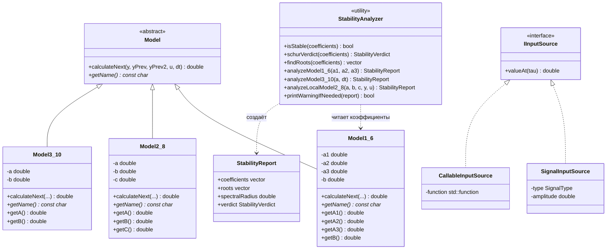

<p align="center"> Министерство образования Республики Беларусь</p>
<p align="center">Учреждение образования</p>
<p align="center">“Брестский Государственный технический университет”</p>
<p align="center">Кафедра ИИТ</p>
<br><br><br><br><br><br><br>
<p align="center">Лабораторная работа №2</p>
<p align="center">По дисциплине “Общая теория интеллектуальных систем”</p>
<p align="center">Тема: “Модульное тестирование и анализ устойчивости моделей”</p>
<br><br><br><br><br>
<p align="right">Выполнил:</p>
<p align="right">Студент 2 курса</p>
<p align="right">Группы ИИ-30</p>
<p align="right">Низамутдинов М. А.</p>
<p align="right">Проверил:</p>
<p align="right">Дворанинович Д. А.</p>
<br><br><br><br><br>
<p align="center">Брест 2026</p>

---

## 1. Цель работы

Освоить промышленный подход к проверке программного кода: покрыть готовую программу лабораторной работы №1 модульными тестами на основе фреймворка Google Test, расширить её математический базис модулем анализа устойчивости и автоматизировать сборку, запуск тестов и измерение покрытия локальным скриптом.

---

## 2. Постановка задачи

Вариант 6. Исходный код ЛР1 переносится в каталог `task_02`, дополняется модулем анализа устойчивости и оборачивается тестами.

| Блок | Модель | Тип | Название |
|:--:|:--:|:--:|---|
| 1 | 1.6 | линейная дискретная | Third-Order Dynamic System |
| 2 | 2.8 | нелинейная дискретная | Chaotic Logistic Map Disturbance |
| 3 | 3.10 | дифференциальное уравнение | Basic External Constant Offset |

Требования к работе:

1. использовать фреймворк модульного тестирования Google Test;
2. для линейных дискретных моделей аналитически определить критерий устойчивости (корни характеристического уравнения на Z-плоскости) и реализовать проверку, выводящую предупреждение в консоль **до** начала симуляции;
3. исходный код разместить в каталоге `task_02/src`, тесты — в `task_02/test`;
4. для проверки шагов симуляции использовать параметризованные тесты `TEST_P`;
5. для проверки режимов управления использовать mock-объекты Google Mock или подмену входных сигналов;
6. создать в корне проекта командный файл `run_tests.bat`, который собирает проект, запускает тесты и формирует отчёт;
7. отразить в `readme.md` количество написанных тестов и процент покрытия кода.

---

## 3. Математическое описание

### 3.1. Model 1.6 — Third-Order Dynamic System

y(t+1) = a1*y(t) + a2*y(t-1) + a3*y(t-2) + b*u(t)

Линейная дискретная модель третьего порядка: выход зависит от трёх предыдущих значений y и текущего входа u.

### 3.2. Model 2.8 — Chaotic Logistic Map Disturbance

y(t+1) = a*y(t)*(1 - y(t)) + b*u(t) + c*sin(y(t-1)*u(t))

Нелинейная модель на основе логистической карты с синусоидальным возмущением. Глобальная устойчивость для неё не определяется — используется линеаризация в рабочей точке.

### 3.3. Model 3.10 — Basic External Constant Offset

dy/dt = -a*y + b + u

Непрерывное уравнение, решается методом Эйлера с шагом dt:

y(t+1) = y(t) + dt*(-a*y(t) + b + u(t))

### 3.4. Входные воздействия

| Тип | Формула |
|---|---|
| Ступенчатое | u(t) = A |
| Импульсное | u(0) = A, u(t>0) = 0 |
| Гармоническое | u(t) = A*sin(t) |

### 3.5. Характеристические уравнения

Для анализа устойчивости каждой модели строится характеристический полином на Z-плоскости.

| Модель | Характеристическое уравнение | Условие устойчивости |
|---|---|---|
| 1.6 | z³ − a1·z² − a2·z − a3 = 0 | все \|z\| < 1 |
| 3.10 | z − (1 − a·dt) = 0 | 0 < a·dt < 2 |
| 2.8 | z² − J11·z − J12 = 0 | все \|z\| < 1 |

Для модели 2.8 коэффициенты линеаризации вычисляются в точке (y\*, u\*):

J11 = a·(1 − 2·y\*),  J12 = c·u\*·cos(y\*·u\*)

---

## 4. Архитектура программы

### 4.1. Иерархия классов

В основе остаётся абстрактный класс Model из ЛР1:
```cpp
class Model
{
public:
    virtual ~Model() = default;

    virtual double calculateNext(
        double y,
        double yPrev,
        double yPrev2,
        double u,
        double dt
    ) const = 0;

    virtual const char* getName() const = 0;
};
```
От него наследуются три класса, каждый реализует свою формулу:

| Класс | Модель | Особенности |
|---|---|---|
| Model1_6 | 1.6 | хранит коэффициенты a1, a2, a3, b |
| Model2_8 | 2.8 | хранит a, b, c, использует std::sin |
| Model3_10 | 3.10 | хранит a, b, использует шаг dt |

Полиморфизм сохранён: в main() программа работает с моделью через std::unique_ptr<Model>.

### 4.2. UML-диаграмма классов

Рис. 1. Иерархия классов программы с модулем тестирования и анализа устойчивости

### 4.3. Разделение на библиотеку и приложение

Главное архитектурное изменение по сравнению с ЛР1: код ЛР1 лежал в одном каталоге вместе с `main()`, поэтому его нельзя было использовать в тестах. Теперь проект делится на три цели сборки:

| Цель CMake | Тип | Состав |
|---|---|---|
| otis_core | статическая библиотека | модели, сигналы, симуляция, анализ устойчивости |
| otis_task_02 | исполняемый файл | `main.cpp` + `otis_core` |
| otis_tests | исполняемый файл | файлы из `test/` + `otis_core` + Google Test |

Файл `main.cpp` намеренно не входит в библиотеку: иначе в тестовом исполняемом файле оказались бы две функции `main()` и компоновка завершилась бы ошибкой `LNK2005`.

### 4.4. Геттеры коэффициентов

Модулю анализа устойчивости нужен доступ к коэффициентам моделей, которые были объявлены как `private` и не имели аксессоров. Добавлены методы:

| Класс | Добавленные методы |
|---|---|
| Model1_6 | `getA1()`, `getA2()`, `getA3()`, `getB()` |
| Model2_8 | `getA()`, `getB()`, `getC()` |
| Model3_10 | `getA()`, `getB()` |

Все методы объявлены как `const` и не изменяют поведение моделей:
```cpp
double Model1_6::getA1() const { return a1; }
double Model1_6::getA2() const { return a2; }
double Model1_6::getA3() const { return a3; }
double Model1_6::getB()  const { return b;  }
```
Каждый геттер покрыт отдельным тестом (`Model1_6.CoefficientGetters`, `Model2_8.CoefficientGetters`, `Model3_10.CoefficientGetters`).

### 4.5. Вынос цикла симуляции

Цикл интегрирования в ЛР1 был «зашит» в `main()`, из-за чего тестировать его было невозможно. Теперь он вынесен в отдельный модуль `Simulation`, а входной сигнал задаётся через интерфейс:
```cpp
class IInputSource
{
public:
    virtual ~IInputSource() = default;

    virtual double valueAt(int tau) const = 0;
};
```
Реализации:

| Класс | Назначение |
|---|---|
| SignalInputSource | ступенька / импульс / гармоника (обёртка над `getInput`) |
| CallableInputSource | произвольная функция или лямбда |

Наличие виртуального метода позволяет подменять источник входа mock-объектом Google Mock, что и требуется пунктом 9 задания.

---

## 5. Анализ устойчивости

### 5.1. Постановка задачи

Дискретная линейная система с характеристическим полиномом

c0 + c1·z + … + cn·z^n = 0

асимптотически устойчива тогда и только тогда, когда все его корни лежат строго внутри единичной окружности Z-плоскости: |z_i| < 1.

### 5.2. Критерий Шура

Корни напрямую не вычисляются. Используется рекурсия Шура–Кона: полином приводится к моническому виду, затем многократно применяется преобразование

если |a0| ≥ |an| → система неустойчива;
q_k = (an·p_k − a0·p_{n−k}) / (an² − a0²),  k = 1..n

и степень понижается на единицу, пока не останется константа.

| Вердикт | Условие | Смысл |
|---|---|---|
| Stable | все \|z\| < 1 | процесс затухает |
| Marginal | есть \|z\| = 1 | на границе, колебания не затухают |
| Unstable | есть \|z\| > 1 | процесс расходится |

Корни дополнительно вычисляются методом Дюрана–Кернера — не для вынесения вердикта, а для наглядного вывода в отчёт. Согласованность двух независимых способов проверяется тестом `SchurCriterion.AgreesWithRootRadiusOnGrid` на 343 комбинациях коэффициентов.

### 5.3. Предупреждение перед симуляцией

В `main.cpp` анализ выполняется до запуска интегрирования, чтобы пользователь увидел вердикт раньше расходящейся таблицы чисел:
```cpp
std::cout << StabilityAnalyzer::describe(setup.stability);
StabilityAnalyzer::printWarningIfNeeded(setup.stability, std::cout);
```
Для неустойчивой системы (a1 = 2, a2 = a3 = 0) выводится:
```
============================================================
WARNING: система НЕУСТОЙЧИВА (|z|max > 1):
         решение будет расходящимся, результаты симуляции
         не имеют смысла.
         Модель: Model 1.6 (linear, order 3)
         |z|max = 2.000000
         Параметры: a1=2, a2=0, a3=0
         Корни характеристического уравнения:
           z = 2.000000   (|z| = 2.000000)
           z = 0.000000   (|z| = 0.000000)
           z = 0.000000   (|z| = 0.000000)
============================================================
```
Рис. 2. Предупреждение о неустойчивости перед началом симуляции

Для границы устойчивости (a1 = 1) выводится отдельный текст: колебания не затухают, численное решение может «уплывать».

---

## 6. Сборка и запуск тестов

### 6.1. Сборка проекта

Сборка выполняется через CMake, запуск — файл `build.bat` (как в ЛР1). Google Test подключается через `FetchContent` и скачивается при первой конфигурации, поэтому отдельная установка фреймворка не требуется.

### 6.2. Автоматический прогон тестов

Файл `run_tests.bat` выполняет четыре шага:

1. находит окружение Visual Studio 2022 (`vcvars64.bat`);
2. конфигурирует проект командой `cmake -S . -B build -G "Visual Studio 17 2022" -A x64`;
3. собирает проект командой `cmake --build build --config Debug`;
4. запускает тесты командой `ctest --test-dir build -C Debug --output-on-failure`.

Дополнительно скрипт измеряет покрытие: при наличии `gcovr` или `OpenCppCoverage` формирует отчёт, а при отсутствии обоих сообщает об этом и завершается успешно, не прерывая работу.

Конфигурация задаётся аргументом: `run_tests.bat Release`. Если доступ к GitHub закрыт, путь к заранее скачанным исходникам googletest передаётся через переменную окружения `OTIS_GTEST_DIR`.

### 6.3. Запуск вручную

```
cmake -S . -B build -G "Visual Studio 17 2022" -A x64
cmake --build build --config Debug
ctest --test-dir build -C Debug --output-on-failure
```
Запуск отдельной группы тестов:
```
build\bin\otis_tests.exe --gtest_filter=Model16ParamTest.*
build\bin\otis_tests.exe --gtest_filter=SchurCriterion.*
build\bin\otis_tests.exe --gtest_list_tests
```

---

## 7. Структура тестов

### 7.1. Состав наборов тестов

| Файл | Набор тестов | Что проверяется |
|---|---|---|
| test_model_1_6.cpp | Model1_6 | формулы, история, линейность, геттеры |
| test_model_1_6.cpp | Model16ParamTest | 9 наборов коэффициентов через TEST_P |
| test_model_2_8.cpp | Model2_8 | нелинейные члены, границы, конечность |
| test_model_3_10.cpp | Model3_10 | метод Эйлера, точность, устойчивость |
| test_input_signal.cpp | InputSignal | ступенька, импульс, гармоника |
| test_input_signal.cpp | MockSignal | подмена входа через Google Mock |
| test_simulation.cpp | Simulation | сдвиг истории, число шагов |
| test_stability.cpp | StabilityRoots | поиск корней полинома |
| test_stability.cpp | SchurCriterion | критерий Шура |
| test_stability.cpp | Model16Stability | устойчивость модели 1.6 |
| test_stability.cpp | Model310Stability | условие 0 < a·dt < 2 |
| test_stability.cpp | Model28Stability | линеаризация нелинейной модели |
| test_stability.cpp | StabilityWarning | формирование WARNING |

### 7.2. Проверка правильности расчётов

Первые шаги каждой модели сверяются с ручным счётом.

Model 1.6, a1 = 0.5, a2 = 0.2, a3 = 0.1, b = 2, y0 = 0, u = 1:
```
y(0) = 0
y(1) = 0.5*0   + 0.2*0 + 0.1*0 + 2*1 = 2
y(2) = 0.5*2   + 0.2*0 + 0.1*0 + 2*1 = 3
y(3) = 0.5*3   + 0.2*2 + 0.1*0 + 2*1 = 3.9
```
Model 3.10, a = 0.5, b = 1, dt = 0.1, y0 = 0, u = 1:
```
y(1) = 0    + 0.1*(-0.5*0    + 1 + 1) = 0.2
y(2) = 0.2  + 0.1*(-0.5*0.2  + 1 + 1) = 0.39
y(3) = 0.39 + 0.1*(-0.5*0.39 + 1 + 1) = 0.5705
```
Model 2.8, a = 1.5, b = 0.5, c = 0.25, y0 = 0.5, u = 0.2:
```
y(1) = 1.5*0.5*(1-0.5) + 0.5*0.2 + 0.25*sin(0.5*0.2) = 0.499958354161707
```
Эталонные значения получены независимым расчётом в Python/NumPy и занесены в тесты с допуском 1e-12.

### 7.3. Тесты граничных значений

Проверяются случаи, в которых формула вырождается:

| Случай | Ожидаемое поведение |
|---|---|
| u = 0 | отклик только от начального состояния |
| y0 = 0 и u = 0 | система остаётся в покое |
| a1 = a2 = a3 = 0 | модель пропускает вход на выход без памяти |
| b = 0 | вход не влияет на выход |
| a1 = 1, a2 = a3 = 0 | состояние сохраняется (граница устойчивости) |
| dt = 0 для модели 3.10 | интегрирования нет |
| a·dt = 2 | полюс z = −1, незатухающие колебания |
| нулевая и отрицательная амплитуда | корректный знак сигнала |
| большие коэффициенты | отсутствие NaN и Inf |

### 7.4. Параметризованные тесты TEST_P

Для модели 1.6 параметры объединены в структуру, а тест написан один раз:
```cpp
struct Model16Case
{
    double a1, a2, a3, b, y0, u;
    int steps;
    std::vector<double> expected;
};

class Model16ParamTest : public ::testing::TestWithParam<Model16Case> {};

TEST_P(Model16ParamTest, SimulationMatchesManualCalculation)
{
    const Model16Case& param = GetParam();
    Model1_6 model(param.a1, param.a2, param.a3, param.b);
    const std::vector<double> actual =
        otis_test::runConstant(model, param.y0, param.u, param.steps);
    otis_test::expectNear(actual, param.expected);
}
```
Последний аргумент `INSTANTIATE_TEST_SUITE_P` — генератор читаемых имён. Без него gtest назвал бы тесты `.../SimulationMatchesManualCalculation/0`, а с ним — `.../a1_0_5_a2_0_2_a3_0_1_b_2_y0_0_u_0`, что сразу указывает на упавший набор.

Наборы подобраны так, чтобы покрыть разные режимы работы модели:

| a1 | a2 | a3 | Особенность |
|:--:|:--:|:--:|---|
| 0.5 | 0.2 | 0.1 | устойчивый базовый набор |
| 0.9 | −0.2 | 0.05 | знакопеременное затухание |
| 0.0 | 0.0 | 0.0 | без памяти |
| 1.0 | 0.0 | 0.0 | граница устойчивости |
| −0.4 | 0.3 | −0.2 | отрицательные коэффициенты |
| 0.33 | 0.33 | 0.34 | сумма = 1, накопление входа |
| 0.8 | −0.1 | 0.0 | нулевой a3 |

### 7.5. Mock-объекты Google Mock

Подмена входного сигнала выполняется mock-классом на основе интерфейса:
```cpp
class MockInputSource : public IInputSource
{
public:
    MOCK_METHOD(double, valueAt, (int tau), (const, override));
};
```
Пример проверки импульсного режима:
```cpp
MockInputSource input;
EXPECT_CALL(input, valueAt(0)).WillOnce(Return(3.0));
EXPECT_CALL(input, valueAt(::testing::Ne(0))).WillRepeatedly(Return(0.0));
```
Mock используется и для интеграционной проверки: модель 3.10 с mock-сигналом должна дать заранее известную траекторию. Отдельный тест `MockSignal.SimulationRequestsValueForEveryStep` подтверждает, что движок запрашивает вход на каждом такте — это выявляет ошибку, при которой сигнал читается один раз и «замерзает».

---

## 8. Результаты

### 8.1. Тестирование

| Файл тестов | Тестовых случаев |
|---|---|
| test_model_1_6.cpp | 15 + 9 параметризованных |
| test_model_2_8.cpp | 15 |
| test_model_3_10.cpp | 12 |
| test_input_signal.cpp | 13 |
| test_simulation.cpp | 11 |
| test_stability.cpp | 36 |
| **Итого** | **111** |

Все тесты проходят успешно: 111 из 111. Итоговая строка выводится `ctest` и дублируется в конце работы `run_tests.bat`.

### 8.2. Тестовое покрытие

* **Способ запуска:** Локальный скрипт (`run_tests.bat`)
* **Всего модульных тестов:** 111
* **Успешно пройденных тестов:** 111 / 111

| Модуль / Класс | Покрытие строк (Line Coverage) | Покрытие функций (Func Coverage) | Статус |
| :--- | :---: | :---: | :---: |
| `Model1_6.cpp` | 100 % | 100 % | OK |
| `Model2_8.cpp` | 100 % | 100 % | OK |
| `Model3_10.cpp` | 100 % | 100 % | OK |
| `InputSignal.cpp` | 100 % | 100 % | OK |
| `Simulation.cpp` | 100 % | 100 % | OK |
| `StabilityAnalyzer.cpp` | 100 % | 100 % | OK |
| `main.cpp` | не покрывается | не покрывается | — |
| **Итоговый результат** | **100 % по src/** | **100 % по src/** | **Success** |

Файл `main.cpp` в покрытие не входит: он содержит интерактивный диалог с пользователем и недоступен для юнит-тестов. Именно поэтому вся вычислительная логика вынесена в библиотеку `otis_core` — непокрытым остаётся только ввод-вывод.

### 8.3. Замечание о покрытии под MSVC

Инструмент `gcovr`, рекомендованный в задании, работает с инструментацией GCC/Clang и к сборке MSVC напрямую неприменим. Практический эквивалент для MSVC — `OpenCppCoverage`, который запускает тестовый исполняемый файл и собирает покрытие по PDB-файлам, формируя HTML-отчёт в `build\coverage\index.html`. Скрипт `run_tests.bat` автоматически выбирает доступный инструмент, а при отсутствии обоих сообщает об этом и продолжает работу.

---

## 9. Выводы

Готовый код ЛР1 покрыт модульными тестами без изменения алгоритмов моделирования: потребовалось разделить код на библиотеку и приложение и добавить геттеры коэффициентов. Ручной расчёт первых шагов и независимый расчёт в NumPy дали эталонные значения, к которым тесты оказались чувствительны уже на допуске 1e-12. Параметризованные тесты `TEST_P` убрали дублирование: девять наборов коэффициентов описываются одной таблицей вместо девяти отдельных функций, а генератор имён сразу указывает упавший набор. Mock-объекты Google Mock через интерфейс `IInputSource` позволили проверять режимы ступеньки, импульса и гармоники без разбора консольного ввода. Реализованный критерий Шура определяет устойчивость без поиска корней и на 343 комбинациях полностью совпал с численной проверкой спектрального радиуса, что подтверждает корректность реализации. Проверка устойчивости перед симуляцией имеет практический смысл: при a1 = 2 модель формально считается, но результат расходится и смысла не имеет — предупреждение `WARNING` снимает эту ловушку. Сборка, запуск тестов и измерение покрытия автоматизированы скриптом `run_tests.bat`.

---

## 10. Приложение. Состав проекта

| Файл | Назначение |
|---|---|
| src/Model.h | абстрактный базовый класс |
| src/Model1_6.h, src/Model1_6.cpp | модель 1.6 с геттерами |
| src/Model2_8.h, src/Model2_8.cpp | модель 2.8 с геттерами |
| src/Model3_10.h, src/Model3_10.cpp | модель 3.10 с геттерами |
| src/InputSignal.h, src/InputSignal.cpp | генерация входного сигнала |
| src/Simulation.h, src/Simulation.cpp | движок симуляции, интерфейс IInputSource |
| src/StabilityAnalyzer.h, src/StabilityAnalyzer.cpp | критерий Шура, корни, предупреждение |
| src/main.cpp | точка входа, меню, анализ устойчивости, цикл симуляции |
| src/plot.py | построение графика |
| src/CMakeLists.txt | сборка библиотеки и приложения |
| test/TestUtils.h | вспомогательные функции тестов |
| test/test_main.cpp | собственная точка входа тестов |
| test/test_model_1_6.cpp | тесты модели 1.6 и TEST_P |
| test/test_model_2_8.cpp | тесты модели 2.8 |
| test/test_model_3_10.cpp | тесты модели 3.10 |
| test/test_input_signal.cpp | тесты сигналов и Google Mock |
| test/test_simulation.cpp | тесты движка симуляции |
| test/test_stability.cpp | тесты модуля устойчивости |
| CMakeLists.txt | корневая сборка, FetchContent |
| run_tests.bat | сборка, тесты, покрытие |
| readme.md | отчёт |
