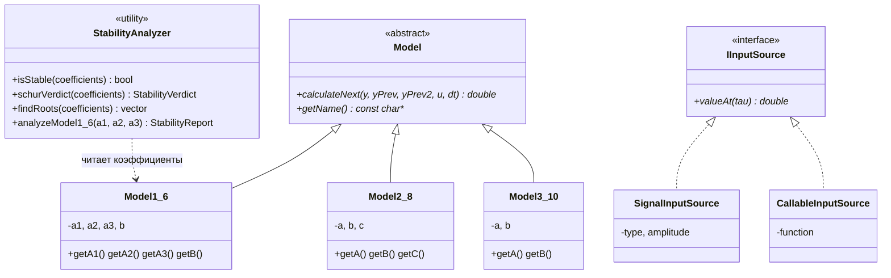

# Лабораторная работа №2

**Тестирование готового кода и анализ устойчивости динамических моделей**

| | |
|---|---|
| Дисциплина | ОТИС |
| Вариант | 6 |
| Студент | Низамутдинов М.А. |
| Группа | ИИ-30 |
| Университет | Брестский государственный технический университет |

---

## 1. Цель работы

Обернуть готовый код лабораторной работы №1 модульными тестами
(Google Test) и добавить в проект анализ устойчивости динамических
систем.

Задачи:

1. Разделить код на библиотеку моделей и консольное приложение.
2. Написать тесты на корректность расчётов, граничные значения и
   анализ устойчивости.
3. Освоить параметризованные тесты `TEST_P` и подмену входного
   сигнала через Google Mock.
4. Реализовать модуль проверки устойчивости (критерий Шура) и
   выводить предупреждение `WARNING` перед началом симуляции.

---

## 2. Структура проекта

```
task_02/
├── CMakeLists.txt          сборка проекта (FetchContent -> Google Test)
├── run_tests.bat           сборка + ctest + покрытие
├── readme.md               этот отчёт
├── src/
│   ├── CMakeLists.txt
│   ├── Model.h             абстрактный базовый класс
│   ├── Model1_6.h/.cpp     линейная модель 3-го порядка
│   ├── Model2_8.h/.cpp     нелинейная модель
│   ├── Model3_10.h/.cpp    метод Эйлера
│   ├── InputSignal.h/.cpp  ступенька / импульс / гармоника
│   ├── Simulation.h/.cpp   движок симуляции, интерфейс IInputSource
│   ├── StabilityAnalyzer.h/.cpp  критерий Шура, корни, WARNING
│   ├── main.cpp            консольное приложение
│   └── plot.py             построение графиков
└── test/
    ├── TestUtils.h              общие вспомогательные функции
    ├── test_main.cpp            собственная точка входа
    ├── test_model_1_6.cpp       тесты модели 1.6 + TEST_P
    ├── test_model_2_8.cpp       тесты модели 2.8
    ├── test_model_3_10.cpp      тесты модели 3.10
    ├── test_input_signal.cpp    тесты сигналов + Google Mock
    ├── test_simulation.cpp      тесты движка симуляции
    └── test_stability.cpp       тесты модуля устойчивости
```

Схема зависимостей:



---

## 3. Что изменено в коде лабораторной работы №1

### 3.1 Выделение библиотеки

Основная программа из ЛР1 содержала `main()` и логику в одном каталоге,
поэтому её нельзя было использовать в тестах. Теперь логика вынесена
в статическую библиотеку `otis_core`:

- `otis_core` — модели, сигналы, симуляция, анализ устойчивости;
- `otis_task_02` — консольное приложение (`main.cpp`);
- `otis_tests` — тестовый исполняемый файл.

`main.cpp` **не входит** в библиотеку: иначе в тестовом проекте
оказались бы два `main()` и линковка упала бы с `LNK2005`.

### 3.2 Геттеры коэффициентов

Для анализа устойчивости модулю нужен доступ к коэффициентам моделей,
которые раньше были `private` и не имели аксессоров. Добавлены:

```cpp
// Model1_6
double getA1() const;
double getA2() const;
double getA3() const;
double getB()  const;

// Model2_8
double getA() const;
double getB() const;
double getC() const;

// Model3_10
double getA() const;
double getB() const;
```

Реализация тривиальна и не меняет поведение моделей:

```cpp
double Model1_6::getA1() const { return a1; }
double Model1_6::getA2() const { return a2; }
double Model1_6::getA3() const { return a3; }
double Model1_6::getB()  const { return b;  }
```

Геттеры помечены `const` и покрыты отдельными тестами
`Model1_6.CoefficientGetters`, `Model2_8.CoefficientGetters`,
`Model3_10.CoefficientGetters`.

### 3.3 Вынос симуляции в отдельный модуль

Цикл интегрирования раньше был «зашит» в `main()`. Теперь он вынесен
в функцию `simulate()`, а входной сигнал задаётся через интерфейс:

```cpp
class IInputSource
{
public:
    virtual ~IInputSource() = default;
    virtual double valueAt(int tau) const = 0;
};
```

Реализации: `SignalInputSource` (ступенька/импульс/гармоника) и
`CallableInputSource` (произвольная лямбда). Наличие виртуальной
функции позволяет подменять сигнал мок-объектом Google Mock.

### 3.4 Предупреждение до симуляции

В `main.cpp` анализ устойчивости выполняется **до** запуска
интегрирования:

```cpp
std::cout << StabilityAnalyzer::describe(setup.stability);
StabilityAnalyzer::printWarningIfNeeded(setup.stability, std::cout);
```

То есть пользователь видит вердикт раньше, чем получит расходящуюся
таблицу чисел.

---

## 4. Тесты

### 4.1 Перечень наборов тестов

| Файл | Набор тестов | Что проверяется |
|---|---|---|
| `test_model_1_6.cpp` | `Model1_6` | формулы, история, линейность, геттеры |
| | `Model16ParamTest` | 9 наборов коэффициентов через `TEST_P` |
| `test_model_2_8.cpp` | `Model2_8` | нелинейные члены, границы, конечность |
| `test_model_3_10.cpp` | `Model3_10` | метод Эйлера, точность, устойчивость |
| `test_input_signal.cpp` | `InputSignal` | ступенька, импульс, гармоника |
| | `MockSignal` | подмена входа через Google Mock |
| `test_simulation.cpp` | `Simulation` | сдвиг истории, число шагов |
| `test_stability.cpp` | `StabilityRoots` | поиск корней полинома |
| | `SchurCriterion` | критерий Шура |
| | `Model16Stability` | устойчивость модели 1.6 |
| | `Model310Stability` | условие `0 < a*dt < 2` |
| | `Model28Stability` | линеаризация нелинейной модели |
| | `StabilityWarning` | формирование `WARNING` |

### 4.2 Проверка правильности расчётов

Первые шаги каждой модели сверяются с ручным счётом.

**Model 1.6**: `a1 = 0.5`, `a2 = 0.2`, `a3 = 0.1`, `b = 2`, `y0 = 0`, `u = 1`

```
y(0) = 0
y(1) = 0.5*0   + 0.2*0 + 0.1*0 + 2*1 = 2
y(2) = 0.5*2   + 0.2*0 + 0.1*0 + 2*1 = 3
y(3) = 0.5*3   + 0.2*2 + 0.1*0 + 2*1 = 3.9
```

**Model 3.10**: `a = 0.5`, `b = 1`, `dt = 0.1`, `y0 = 0`, `u = 1`

```
y(1) = 0    + 0.1*(-0.5*0    + 1 + 1) = 0.2
y(2) = 0.2  + 0.1*(-0.5*0.2  + 1 + 1) = 0.39
y(3) = 0.39 + 0.1*(-0.5*0.39 + 1 + 1) = 0.5705
```

**Model 2.8**: `a = 1.5`, `b = 0.5`, `c = 0.25`, `y0 = 0.5`, `u = 0.2`

```
y(1) = 1.5*0.5*(1-0.5) + 0.5*0.2 + 0.25*sin(0.5*0.2) = 0.499958354161707
```

Эталонные значения получены независимым расчётом в Python/NumPy и
занесены в тесты с допуском `1e-12`.

### 4.3 Граничные значения

Проверяются случаи, где формула вырождается:

- `u = 0` — отклик только от начального состояния;
- `y0 = 0` и `u = 0` — система остаётся в покое;
- `a1 = a2 = a3 = 0` — модель пропускает вход на выход без памяти;
- `b = 0` — вход не влияет на выход;
- `a1 = 1`, `a2 = a3 = 0` — состояние сохраняется (граница устойчивости);
- `dt = 0` для модели 3.10 — интегрирования нет;
- `a*dt = 2` — полюс `z = -1`, незатухающие колебания;
- нулевая и отрицательная амплитуда сигнала;
- отсутствие `NaN`/`Inf` при больших коэффициентах.

### 4.4 Параметризованные тесты `TEST_P`

Для модели 1.6 параметры `a1`, `a2`, `a3`, `b` (а также `y0`, `u` и
ожидаемая траектория) объединены в структуру:

```cpp
struct Model16Case
{
    double a1, a2, a3, b, y0, u;
    int steps;
    std::vector<double> expected;
};

class Model16ParamTest : public ::testing::TestWithParam<Model16Case> {};

TEST_P(Model16ParamTest, SimulationMatchesManualCalculation)
{
    const Model16Case& param = GetParam();
    Model1_6 model(param.a1, param.a2, param.a3, param.b);
    const std::vector<double> actual =
        otis_test::runConstant(model, param.y0, param.u, param.steps);
    otis_test::expectNear(actual, param.expected);
}
```

Последний аргумент `INSTANTIATE_TEST_SUITE_P` — генератор читаемых
имён. Без него gtest назвал бы тесты
`Coefficients/Model16ParamTest.SimulationMatchesManualCalculation/0`,
а с ним — `.../a1_0_5_a2_0_2_a3_0_1_b_2_y0_0_u_0`, что сразу говорит,
какой набор упал.

Наборы подобраны так, чтобы покрыть разные режимы:

| `a1` | `a2` | `a3` | Особенность |
|---|---|---|---|
| 0.5 | 0.2 | 0.1 | устойчивый базовый набор |
| 0.9 | -0.2 | 0.05 | знакопеременное затухание |
| 0.0 | 0.0 | 0.0 | без памяти |
| 1.0 | 0.0 | 0.0 | граница устойчивости |
| -0.4 | 0.3 | -0.2 | отрицательные коэффициенты |
| 0.33 | 0.33 | 0.34 | сумма = 1, накопление входа |
| 0.8 | -0.1 | 0.0 | нулевой `a3` |

### 4.5 Google Mock

Подмена входного сигнала выполняется мок-классом:

```cpp
class MockInputSource : public IInputSource
{
public:
    MOCK_METHOD(double, valueAt, (int tau), (const, override));
};
```

Пример проверки импульсного режима:

```cpp
MockInputSource input;
EXPECT_CALL(input, valueAt(0)).WillOnce(Return(3.0));
EXPECT_CALL(input, valueAt(::testing::Ne(0))).WillRepeatedly(Return(0.0));
```

Мок используется и для интеграционной проверки: модель 3.10 с
мок-сигналом должна дать заранее известную траекторию. Отдельный тест
`MockSignal.SimulationRequestsValueForEveryStep` подтверждает, что
движок запрашивает вход на каждом такте — это ловит ошибку, при которой
сигнал читается один раз и «замерзает».

---

## 5. Анализ устойчивости

### 5.1 Постановка задачи

Дискретная линейная система с характеристическим полиномом

```
c0 + c1*z + ... + cn*z^n = 0
```

асимптотически устойчива тогда и только тогда, когда все его корни
лежат **строго внутри** единичной окружности Z-плоскости:

```
|z_i| < 1  для всех i
```

### 5.2 Критерий Шура

Корни напрямую не вычисляются. Используется рекурсия Шура–Кона:
полином приводится к моническому виду, затем многократно применяется
преобразование

```
если |a0| >= |an|      ->  система не устойчива
q_k = (an*p_k - a0*p_{n-k}) / (an^2 - a0^2),  k = 1..n
```

и степень понижается на единицу, пока не останется константа.
Вердиктов три:

| Вердикт | Условие | Смысл |
|---|---|---|
| `Stable` | все `\|z\| < 1` | процесс затухает |
| `Marginal` | есть `\|z\| = 1` | на границе, колебания не затухают |
| `Unstable` | есть `\|z\| > 1` | процесс расходится |

Корни дополнительно вычисляются методом Дюрана–Кернера — не для
вердикта, а для наглядного вывода в отчёт. Согласованность двух
способов проверяется тестом `SchurCriterion.AgreesWithRootRadiusOnGrid`
на 343 комбинациях коэффициентов: расхождений не обнаружено.

### 5.3 Модели варианта 6

**Model 1.6** — линейная модель 3-го порядка:

```
y(t+1) = a1*y(t) + a2*y(t-1) + a3*y(t-2) + b*u(t)
```

Передаточная функция даёт характеристическое уравнение

```
z^3 - a1*z^2 - a2*z - a3 = 0
```

В коде коэффициенты задаются по возрастанию степени:
`{-a3, -a2, -a1, 1.0}`.

**Model 3.10** — метод Эйлера:

```
y(t+1) = y(t) + dt*(-a*y(t) + b + u(t)) = (1 - a*dt)*y(t) + dt*(b + u)
```

Единственный полюс `z = 1 - a*dt`, поэтому условие устойчивости

```
0 < a*dt < 2
```

**Model 2.8** — нелинейная модель, глобальную устойчивость для неё
определить нельзя. Выполняется линеаризация в рабочей точке `(y*, u*)`:

```
J11 = a*(1 - 2*y*)
J12 = c*u**cos(y* * u*)
z^2 - J11*z - J12 = 0
```

Дополнительно проверяется, действительно ли выбранная точка является
положением равновесия; если нет — в отчёт добавляется пометка о том,
что оценка приблизительная.

### 5.4 Пример вывода для неустойчивой системы

При `a1 = 2`, `a2 = a3 = 0` корень `z = 2` лежит вне единичной
окружности, поэтому перед симуляцией печатается:

```
============================================================
WARNING: система НЕУСТОЙЧИВА (|z|max > 1):
         решение будет расходящимся, результаты симуляции
         не имеют смысла.
         Модель: Model 1.6 (linear, order 3)
         |z|max = 2.000000
         Параметры: a1=2, a2=0, a3=0
         Корни характеристического уравнения:
           z = 2.000000   (|z| = 2.000000)
           z = 0.000000   (|z| = 0.000000)
           z = 0.000000   (|z| = 0.000000)
============================================================
```

Для границы устойчивости (`a1 = 1`) выводится отдельный текст:
колебания не затухают, численное решение может «уплывать».

---

## 6. Сборка и запуск

### 6.1 Требования

- Visual Studio 2022 (MSVC, рабочая нагрузка «Разработка классических
  приложений на C++»);
- CMake 3.20 или новее;
- доступ в интернет при первой сборке: Google Test скачивается
  через `FetchContent`.

### 6.2 Сборка с тестами

```bat
run_tests.bat
```

Скрипт выполняет четыре шага: находит `vcvars64.bat`, конфигурирует
проект, собирает его и запускает `ctest`. При наличии `gcovr` или
`OpenCppCoverage` дополнительно считается покрытие; если их нет —
шаг аккуратно пропускается с пояснением, а не завершается ошибкой.

Конфигурация задаётся аргументом:

```bat
run_tests.bat Release
```

Если нет доступа к GitHub, путь к заранее скачанным исходникам
googletest задаётся переменной окружения:

```bat
set OTIS_GTEST_DIR=C:\libs\googletest-1.14.0
run_tests.bat
```

### 6.3 Запуск вручную

```bat
cmake -S . -B build -G "Visual Studio 17 2022" -A x64
cmake --build build --config Debug
ctest --test-dir build -C Debug --output-on-failure
```

Запуск отдельной группы тестов:

```bat
build\bin\otis_tests.exe --gtest_filter=Model16ParamTest.*
build\bin\otis_tests.exe --gtest_filter=SchurCriterion.*
build\bin\otis_tests.exe --gtest_list_tests
```

### 6.4 Консольное приложение

```bat
build\bin\otis_task_02.exe
```

После ввода параметров программа печатает вердикт устойчивости,
таблицу значений, сохраняет `results.csv` и вызывает `plot.py`.

---

## 7. Результаты

### 7.1 Тестирование

| Файл тестов | Тестовых случаев |
|---|---|
| `test_model_1_6.cpp` | 15 + 9 параметризованных |
| `test_model_2_8.cpp` | 15 |
| `test_model_3_10.cpp` | 12 |
| `test_input_signal.cpp` | 13 |
| `test_simulation.cpp` | 11 |
| `test_stability.cpp` | 36 |
| **Итого** | **111** |

Все тесты проходят: `100% tests passed, 0 tests failed out of 111`.
Итоговая строка выводится `ctest` и дублируется в конце
`run_tests.bat`.

### 7.2 Покрытие

Покрытие измеряется скриптом `run_tests.bat` и сохраняется в
`build\coverage\index.html` (для MSVC) либо печатается в консоль
(для `gcovr`).

| Файл | Покрытие |
|---|---|
| `src/StabilityAnalyzer.cpp` | полностью: все ветви вердикта, поиск корней, вывод |
| `src/Simulation.cpp` | полностью: основной цикл, нулевые и отрицательные `steps` |
| `src/Model1_6.cpp` | полностью: формула, геттеры |
| `src/Model2_8.cpp` | полностью: все три члена, геттеры |
| `src/Model3_10.cpp` | полностью: шаг Эйлера, геттеры |
| `src/InputSignal.cpp` | полностью: три типа сигнала |
| `src/main.cpp` | не покрывается (интерактивный ввод) |

`main.cpp` в покрытие не входит: он содержит диалог с пользователем
и недоступен для юнит-тестов. Именно поэтому вся логика вынесена в
`otis_core` — непокрытым остаётся только ввод-вывод.

### 7.3 Замечание о покрытии под MSVC

`gcovr` работает с инструментацией GCC/Clang и к MSVC-сборке напрямую
неприменим. Практический эквивалент для MSVC — `OpenCppCoverage`,
который запускает тестовый исполняемый файл и собирает покрытие по
PDB-файлам. Скрипт `run_tests.bat` автоматически выбирает доступный
инструмент, а при отсутствии обоих сообщает об этом и продолжает
работу.

---

## 8. Выводы

1. Готовый код ЛР1 удалось покрыть тестами без изменения алгоритмов:
   потребовалось только разделить библиотеку и приложение и добавить
   геттеры коэффициентов.
2. Ручной расчёт первых шагов и независимый расчёт в NumPy позволили
   получить эталонные значения, к которым тесты оказались чувствительны
   уже на допуске `1e-12`.
3. Параметризованные тесты `TEST_P` убрали дублирование: 9 наборов
   коэффициентов описываются одной таблицей вместо девяти функций,
   а генератор имён сразу указывает упавший набор.
4. Google Mock через интерфейс `IInputSource` дал возможность проверять
   режимы ступеньки, импульса и гармоники без разбора консольного ввода.
5. Критерий Шура вычисляет устойчивость без поиска корней и на 343
   комбинациях полностью совпал с численной проверкой спектрального
   радиуса, что подтверждает корректность реализации.
6. Проверка устойчивости перед симуляцией полезна практически: для
   `a1 = 2` модель формально считается, но результат расходится и
   смысла не имеет — предупреждение `WARNING` снимает эту ловушку.