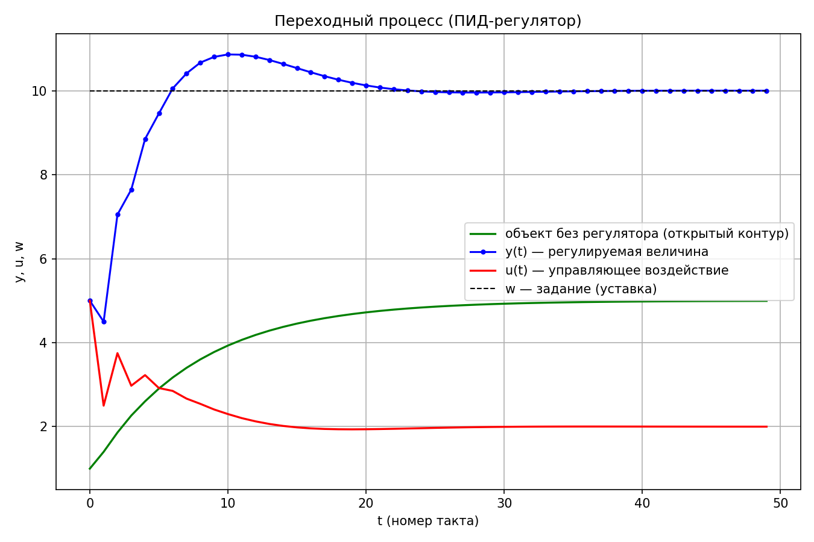
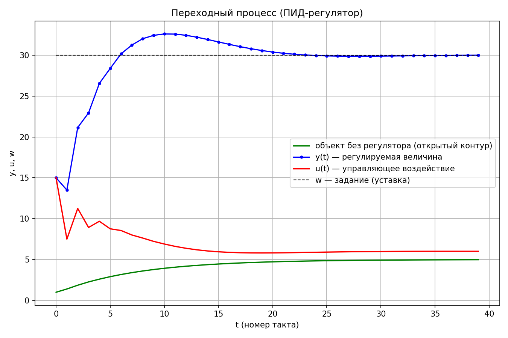
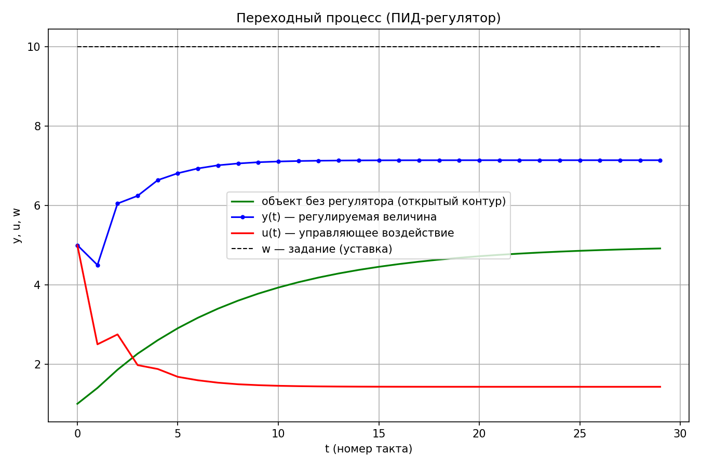
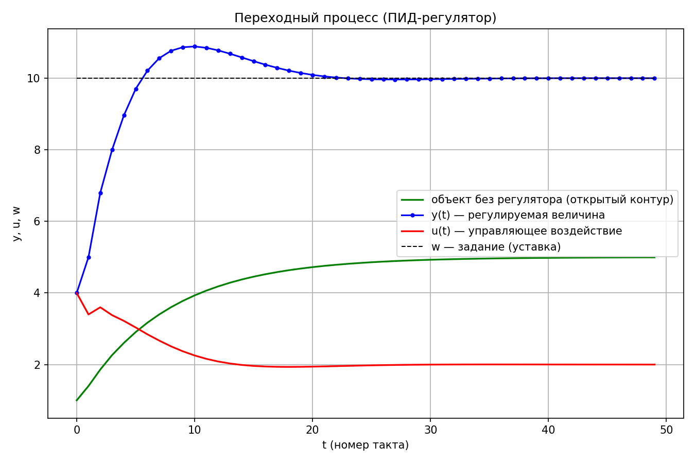
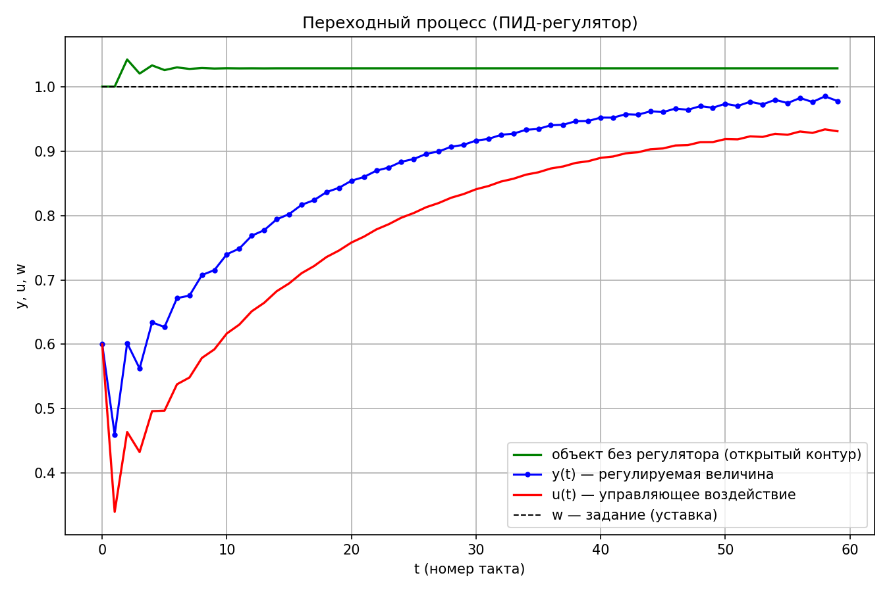
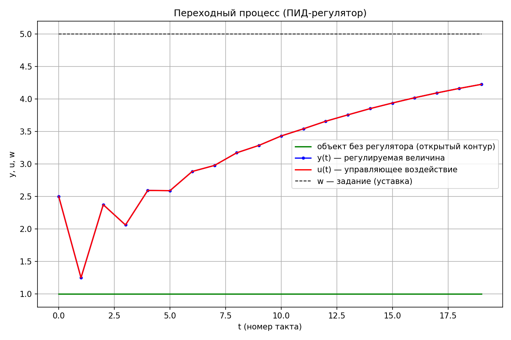
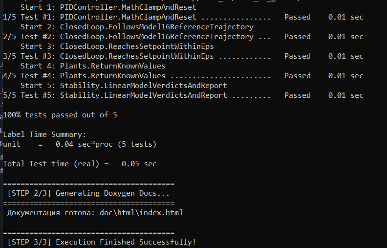

<p align="center"> Министерство образования Республики Беларусь</p>
<p align="center">Учреждение образования</p>
<p align="center">“Брестский Государственный технический университет”</p>
<p align="center">Кафедра ИИТ</p>
<br><br><br><br><br><br><br>
<p align="center">Лабораторная работа №3</p>
<p align="center">По дисциплине “Общая теория интеллектуальных систем”</p>
<p align="center">Тема: “Моделирование температуры объекта”</p>
<br><br><br><br><br>
<p align="right">Выполнил:</p>
<p align="right">Студент 2 курса</p>
<p align="right">Группы ИИ-30</p>
<p align="right">Низамутдинов М. А.</p>
<p align="right">Проверил:</p>
<p align="right">Дворанинович Д. А.</p>
<br><br><br><br><br>
<p align="center">Брест 2026</p>

---

## 1. Цель работы

Собрать **замкнутую систему автоматического управления**: подключить к
математическим моделям объектов из лабораторной работы №1 ПИД-регулятор
(дискретный «алгоритм скорости») и исследовать переходный процесс: выход
объекта на заданное значение, влияние коэффициентов $K_p, K_i, K_d$ на
качество регулирования. Закрепить навыки модульного тестирования (Google Test)
и автоматического документирования кода (Doxygen + GitHub Pages).

## 2. Постановка задачи (требования методички)

1. Отчёт — `task_03/doc/readme.md` (настоящий файл);
2. исходный код в `src/`;
3. строка о работе в общий readme репозитория;
4. документирование кода Doxygen, результат — `doc/html` + GitHub Pages;
5. модульные тесты на Google Test в `test/`;
6. программа выводит результаты **строго таблицей** `t, w, e(t), u(t), y(t)`;
7. графики переходных процессов (через Python/matplotlib);
8. bat-файл полного цикла (сборка → тесты → документация);
9. объект управления = любая из **трёх моделей ЛР1** (линейная 1.6,
   нелинейная 2.8, дифференциальное уравнение 3.10), выбор — в меню;
10. **два режима работы**: А — заданное число тактов $n$; Б — до достижения
    установившегося режима $|e| < \varepsilon$;
11. в отчёте — графики при разных заданиях $w$ и **пошаговая история
    настройки** коэффициентов регулятора.

## 3. ПИД-регулятор: методика и реализация

Классический закон управления: $u(t) = K_p\,e + K_i\!\int e\,dt + K_d\,\frac{de}{dt}$,
где $e(t) = w - y(t)$. По методичке используется его дискретная **рекуррентная
форма («алгоритм скорости»)** — считается приращение управления:

$$
u_{\tau} = u_{\tau-1} + \Delta u_{\tau}, \qquad
\Delta u_{\tau} = K_p (e_{\tau} - e_{\tau-1}) + K_i e_{\tau}\,\Delta t + \frac{K_d}{\Delta t}(e_{\tau} - 2e_{\tau-1} + e_{\tau-2}).
$$

В коде (`src/PIDController.h`) эта же формула после сбора слагаемых $q_0, q_1, q_2$:

```cpp
double dU = Kp * (e - e_prev1)                    // P: приращение ошибки
          + Ki * e * dt                           // I: накопление (интеграл)
          + (Kd / dt) * (e - 2.0 * e_prev1 + e_prev2); // D: вторая разность ошибки
double u = u_prev + dU;
if (u > uMax) u = uMax;                           // обрезка по физике актуатора
else if (u < uMin) u = uMin;
```

Память регулятора — три значения: `u_prev`, `e_prev1 = e(t-1)`,
`e_prev2 = e(t-2)`; перед обновлением ошибок — сдвиг `e_prev2 ← e_prev1 ← e`.
Обрезка в $[u_{min}, u_{max}]$ одновременно играет роль простейшего
**anti-windup** (интегральная составляющая не «наматывается» за пределы
актуатора). Метод `reset()` обнуляет всю память регулятора.

## 4. Объекты управления (модели ЛР1, п. 9)

Меню программы (`main.cpp`) позволяет переключить объект управления:

| № | Модель | Тип | Уравнение |
|---|---|---|---|
| 1.6 | `Model1_6` | линейная | $y(\tau{+}1) = a_1 y(\tau) + a_2 y(\tau{-}1) + a_3 y(\tau{-}2) + b\,u(\tau)$ |
| 2.8 | `Model2_8` | нелинейная | $y(\tau{+}1) = a\,y(\tau)(1 - y(\tau)) + b\,u(\tau) + c\,\sin(y(\tau{-}1)\,u(\tau))$ |
| 3.10 | `Model3_10` | диф. уравнение (Эйлер) | $y(\tau{+}1) = y(\tau) + h\,(-a\,y(\tau) + b + u(\tau))$ |

Перед запуском для **линейной** модели 1.6 печатается отчёт об устойчивости
(`src/StabilityAnalyzer.h` из ЛР2, критерий Шура): при неустойчивом наборе
коэффициентов программа выдаёт предупреждение и спрашивает `Y/N`.

## 5. Параметры демонстрационных прогонов

Основные опыты — на модели **1.6** с устойчивым набором
$a_1 = 0.4,\ a_2 = 0.3,\ a_3 = 0.1,\ b = 1$. Характеристическое уравнение
$z^3 - 0.4z^2 - 0.3z - 0.1 = 0$ имеет корни
$z_1 = 0.874095$, $z_{2,3} = -0.237047 \pm 0.241273i$ —
все внутри единичного круга, спектральный радиус $|z|_{\max} = 0.874095$,
вердикт **STABLE**.

Статический коэффициент усиления объекта
$g = \dfrac{b}{1 - a_1 - a_2 - a_3} = \dfrac{1}{0.2} = 5$. Установившееся
управление для задания $w$: $u^* = w/g$ — это контрольная точка:
для $w = 10$ → $u^* = 2$, для $w = 30$ → $u^* = 6$.

Шаг квантования $\Delta t = 1$, пределы актуатора $u \in [-100, 100]$
(заведомо широкие — регулятор не упирается в насыщение).

## 6. Режим А: вывод строго таблицей (пп. 6, 10)

Прогон: объект 1.6; ПИД $K_p = 0.3,\ K_i = 0.1,\ K_d = 0.1$; $w = 10$; $n = 50$.
Начало таблицы программы (полный файл — `pid_result.csv`):

```
   t        w        e(t)      u(t)      y(t)
   0     10.0000   10.0000    5.0000    5.0000
   1     10.0000    5.0000    2.5000    4.5000
   2     10.0000    5.5000    3.7500    7.0500
   3     10.0000    2.9500    2.9750    7.6450
   4     10.0000    2.3550    3.2275    8.8505
   5     10.0000    1.1495    2.9197    9.4584
   6     10.0000    0.5416    2.8513   10.0543
   7     10.0000   -0.0543    2.6683   10.4126
   8     10.0000   -0.4126    2.5433   10.6705
   9     10.0000   -0.6705    2.4089   10.8063
  10     10.0000   -0.8063    2.2997   10.8647   <- максимум перерегулирования
  11     10.0000   -0.8647    2.2035   10.8583
  12     10.0000   -0.8583    2.1261   10.8094
  ...                            ...
  49     10.0000   -0.0017    2.0000   10.0015   <- u* = w/g = 2.0000
```

Показатели качества: перерегулирование
$\sigma = \dfrac{10.8647 - 10}{10}\cdot 100\% = 8.65\%$ (максимум
$y = 10.8647$ на такте 10), статическая ошибка $\to 0$, установившееся
управление $u \to 2.0000 = 10/5$ — контрольная точка сошлась.
Первые такты совпадают с ручным расчётом рекуррентных формул (приложение 16.3)
— это же проверяет тест `ClosedLoop.FollowsModel16ReferenceTrajectory`.

## 7. Режим Б: до установления $|e| < \varepsilon$ (п. 10)

Те же параметры регулятора и объекта; режим 2, $\varepsilon = 0.05$.
Программа завершилась сообщением:

```
Steady state reached: |e| < 0.0500 in 24 steps.
Data saved to pid_result.csv
```

Это согласуется с режимом А: полоса $|e| < 0.05$ впервые пересекается на
такте $t = 23$ (там $e = -0.0367$), т.е. за 24 такта; предохранительный
лимит 100 000 тактов не понадобился.

## 8. Графики переходных процессов при разных заданиях $w$ (п. 7)

Данные — `pid_result.csv` (формат `t;w;e;u;y;y_open`), построение — `plot.py`.
Формат графика повторяет рисунки методички: один график, три кривые —
зелёная (объект без регулятора, единичный скачок $u = 1$), синяя $y(t)$,
красная $u(t)$, пунктиром задание $w$.

**Прогон 1: $w = 10$** (ПИД 0.3/0.1/0.1): перерегулирование 8.65 %,
$u \to 2.0000$.
**Прогон 2: $w = 30$** (те же коэффициенты): пик $y = 32.5941$ на такте 10
— **то же самое** относительное перерегулирование 8.65 %
($\sigma$ не зависит от амплитуды, т.к. модель линейная и переходный процесс
масштабируется без изменения формы), $u \to 6.0000 = 30/5$ — вторая
контрольная точка подтверждена.




*Рис. 1. Переходный процесс при $w = 10$ (зелёная — объект без регулятора, синяя — $y(t)$, красная — $u(t)$); Рис. 2. те же кривые при $w = 30$*

## 9. Пошаговая настройка коэффициентов (метод последовательного подбора, п. 11)

История настройки на объекте 1.6, $w = 10$ — канал за каналом:

**Шаг 1. Только P: $K_p = 0.5$, $K_i = K_d = 0$.**
Быстро, но закономерно **не доходит** до задания: выход застывает на
$y = 7.1429$, статическая ошибка $e^* = 2.8571$. Это не дефект программы, а
теория: для P-регулятора установившаяся ошибка
$e^* = \dfrac{w}{1 + K_p \cdot g} = \dfrac{10}{1 + 0.5\cdot 5} = \dfrac{10}{3.5} = 2.857$.
Как только ошибка мала, пропорциональный «газ» слабеет и не дожимает.
Перерегулирования нет вообще; $u \to 1.4286$.

**Шаг 2. Добавили I: $K_p = 0.3$, $K_i = 0.1$, $K_d = 0$.**
Интегральная составляющая аккумулирует остаточную ошибку и доводит выход
точно до задания ($y \to 10.0000$, $u \to 2.0000$). Цена — инерция канала:
перерегулирование выросло до **8.86 %** (пик $y = 10.8861$ на такте 10).

**Шаг 3. Добавили D: $K_p = 0.3$, $K_i = 0.1$, $K_d = 0.1$ — принято.**
D-канал реагирует на скорость приближения к заданию и притормаживает заранее:
перерегулирование упало с 8.86 % до **8.65 %** (пик $y = 10.8647$), точность
и установившееся управление сохранились ($u \to 2.0000$).

| Шаг | Коэффициенты | $y^*$ | $e^*$ | $\sigma$, % |
|---|---|---|---|---|
| 1. P | 0.5 / 0 / 0 | 7.1429 | 2.8571 | 0 |
| 2. PI | 0.3 / 0.1 / 0 | 10.0000 | 0 | 8.86 |
| 3. PID | 0.3 / 0.1 / 0.1 | 10.0000 | 0 | **8.65** |




*Рис. 3. P-регулятор: синяя кривая $y(t)$ застывает ниже задания (статическая ошибка); Рис. 4. ПИ-регулятор: $y(t)$ доходит до задания с перерегулированием*

## 10. Работа с другими объектами ЛР1 (п. 9)

**Нелинейная модель 2.8** ($a = 0.5,\ b = 1.0,\ c = 0.05$; ПИД 0.5/0.1/0;
$w = 1$, $u \in [-5, 5]$; $n = 60$). Из-за логистического члена и
sin-возмущения система выходит к заданию с небольшими остаточными
колебаниями: к такту 60 $y \approx 0.98$, $u \approx 0.93$.



*Рис. 5. Нелинейная модель 2.8*

**Дифференциальное уравнение 3.10** ($a = 1,\ b = 0$, шаг Эйлера $h = 1$;
ПИД 0.3/0.1/0.1; $w = 5$; $n = 20$). Так как $b = 0$ и $a\,h = 1$, имеем
$y(\tau{+}1) = u(\tau)$ — выход повторяет управление. Кривая монотонно
подходит к уставке: к такту 20 $y = 4.2275$.



*Рис. 6. Модель в виде дифференциального уравнения 3.10*

## 11. Модульные тесты (п. 5 задания, Google Test)

Файл `test/test_pid.cpp` — **5 тестов, все проходят** (`ctest`: 5/5).
Родственные проверки объединены в укрупнённые `TEST`-наборы с
`SCOPED_TRACE` — это уменьшает число сценариев, сохраняя точность
локализации сбоя.

| Тест | Что доказывает |
|---|---|
| `PIDController.MathClampAndReset` | математика первого/второго такта, обрезка по пределам актуатора, `reset()` обнуляет память |
| `ClosedLoop.FollowsModel16ReferenceTrajectory` | замкнутый контур «ПИД + модель 1.6» повторяет ручной расчёт (4 такта: $u$ = 3.0, 3.1, 3.41, 3.461) |
| `ClosedLoop.ReachesSetpointWithinEps` | сходимость к $w$ в пределах $\varepsilon$ за разумное число тактов |
| `Plants.ReturnKnownValues` | корректность значений всех трёх моделей (1.6, 2.8, 3.10) и `getName()` |
| `Stability.LinearModelVerdictsAndReport` | вердикты устойчивости линейной модели 1.6 (устойчивый/неустойчивый набор, тривиальные полиномы) |

Запуск: `ctest --test-dir build -C Release --output-on-failure` (отчёт
пишется в `test_report.txt`).

Вывод тестового приложения `otis_tests.exe`:



*Рис. 7. Полный вывод модульных тестов ЛР №3 (5 тестов, 4 набора, все PASSED)*

## 12. Документация Doxygen + GitHub Pages (п. 4)

Короткие блоки `/** @file / @brief */` и комментарии `///` во всех заголовках
и `.cpp` каталога `src/`; конфиг — `Doxyfile` (вход `src/`, выход `doc/html/`,
LaTeX выключен, `EXTRACT_ALL = YES`). Генерация выполняется автоматически из
`run_all.bat` (STEP 2/3). Результат — `doc/html/index.html` (44 HTML-файла).
Для публикации через GitHub Pages достаточно выбрать ветку `main` и папку
`/doc/html` в настройках репозитория.

## 13. Скрипты запуска (п. 8)

| Файл | Назначение |
|---|---|
| `run_all.bat` | полный цикл **STEP 1→3**: CMake configure + сборка Release → `ctest` с отчётом в `test_report.txt` → Doxygen → итог. Автоматически находит `doxygen` в PATH или в `%ProgramFiles%\doxygen\bin` |
| `run_program.bat` | интерактивный запуск программы (собирает, если exe ещё нет; после прогона строит `graph.png`, если установлен Python) |
| `src/plot.py` | построение графиков по `pid_result.csv` (копируется рядом с exe при сборке) |

Демонстрационные значения для ввода (по одному числу на строку, в порядке
вопросов программы):

```
             [объект]          [настройка PID]              [задание и режим]
w=10 PID:   1  0.4 0.3 0.1 1 → 0.3  0.1  0.1  1  -100 100 → 10  1  50
w=30 PID:   1  0.4 0.3 0.1 1 → 0.3  0.1  0.1  1  -100 100 → 30  1  40
P (шаг 1):  1  0.4 0.3 0.1 1 → 0.5  0    0    1  -100 100 → 10  1  30
PI (шаг 2): 1  0.4 0.3 0.1 1 → 0.3  0.1  0    1  -100 100 → 10  1  50
режим Б:    1  0.4 0.3 0.1 1 → 0.3  0.1  0.1  1  -100 100 → 10  2  0.05
Model 2.8:  2  0.5 1.0 0.05  → 0.5  0.1  0    1  -5   5   → 1   1  60
Model 3.10: 3  1   0   1     → 0.3  0.1  0.1  1  -100 100 → 5   1  20
```

(1 = модель 1.6, далее $a_1, a_2, a_3, b$; для модели 3.10 — $a, b$, шаг
Эйлера $h$; строки PID: $K_p, K_i, K_d, \Delta t, u_{min}, u_{max}$;
режим 1 = n тактов, режим 2 = $\varepsilon$.)

## 14. Соответствие требованиям

| Требование | Где выполнено |
|---|---|
| 1. Отчёт `doc/readme.md` | настоящий файл |
| 2. Код в `src/` | `PIDController.h`, `main.cpp`, модели 1.6/2.8/3.10, `StabilityAnalyzer` |
| 3. Строка в общий readme | `ii03022 \| task_03 \| PID controller + gtest + doxygen \| 5/5 OK \|` |
| 4. Doxygen, `doc/html`, Pages | раздел 12 (`doc/html/index.html`) |
| 5. Google Test | раздел 11 (5/5) |
| 6. Таблица `t w e(t) u(t) y(t)` | раздел 6, + `pid_result.csv` |
| 7. Графики переходных процессов | разделы 8, 10 (`plot.py`) |
| 8. bat-файл | раздел 13 (`run_all.bat`) |
| 9. Объекты ЛР1, переключение | меню `main.cpp`, разделы 4, 10 |
| 10. Режимы А и Б | разделы 6, 7 |
| 11. Разные $w$ + настройка | разделы 8, 9 |

## 15. Выводы

1. Реализована замкнутая система «ПИД-регулятор + объект ЛР1» с рекуррентным
   законом управления («алгоритм скорости») и обрезкой по пределам актуатора.
2. Программа имитирует все три объекта ЛР1 (выбор в меню, п. 9), работает в
   двух режимах (n тактов / до $|e| < \varepsilon$, п. 10), выводит таблицу
   по п. 6 и CSV для графиков (п. 7).
3. Корректность подтверждена тремя независимыми способами: ручным расчётом
   первых тактов, 5 модульными тестами (тест контура повторяет эталонную
   траекторию) и контрольной точкой статики $u^* = w/g$.
4. Настройка показала классическую картину: P даёт скорость, но оставляет
   статическую ошибку ($e^* = w/(1{+}K_p g)$); I её уничтожает ценой выброса;
   D гасит выброс (8.86 % → 8.65 %).
5. Модуль анализа устойчивости (ЛР2) встроен в проверку линейной модели перед
   стартом симуляции.
6. Проект снабжён bat-автоматизацией полного цикла и авто-документацией
   Doxygen, публикуемой через GitHub Pages.

Цель работы достигнута.

## 16. Приложения

### 16.1. Файлы проекта (`task_03_github/`)

| Файл | Назначение |
|---|---|
| `src/Model.h`, `Model1_6.*`, `Model2_8.*`, `Model3_10.*` | иерархия моделей объектов (из ЛР1) |
| `src/StabilityAnalyzer.*` | отчёт об устойчивости модели 1.6 перед стартом |
| `src/PIDController.h` | ПИД-регулятор, рекуррентная форма |
| `src/main.cpp` | замкнутый контур, меню, таблица, CSV |
| `test/test_pid.cpp` | 5 модульных тестов |
| `CMakeLists.txt` | сборка библиотеки `otis_core`, exe `otis_task_03`, тестов `otis_tests` |
| `src/plot.py` | графики по `pid_result.csv` |
| `run_all.bat`, `run_program.bat` | полный цикл / запуск программы |
| `Doxyfile`, `doc/html/` | документация |
| `doc/Screenshots/` | графики отчёта |
| `doc/readme.md` | настоящий отчёт |

### 16.2. Команды запуска

```
cd task_03_github
run_all.bat        :: сборка + 5 тестов + doxygen
run_program.bat    :: интерактивный прогон контура
python plot.py     :: график по свежему pid_result.csv
```

### 16.3. Ручной контроль первых тактов (режим А, $w = 10$, ПИД 0.3/0.1/0.1)

Память регулятора нулевая: $e_0 = 10$ →
$\Delta u = 0.3{\cdot}(10{-}0) + 0.1{\cdot}10 + 0.1{\cdot}(10{-}0{+}0) = 3 + 1 + 1 = 5$ → $u_0 = 5$;
объект: $y_1 = b\,u_0 = 5$ — совпадает с таблицей (такт $t = 0$).

Такт 1: $e_1 = 10 - 5 = 5$ →
$\Delta u = 0.3{\cdot}(5{-}10) + 0.1{\cdot}5 + 0.1{\cdot}(5 - 2{\cdot}10 + 0) = -1.5 + 0.5 - 1.5 = -2.5$ →
$u_1 = 2.5$;
$y_2 = 0.4{\cdot}5 + 2.5 = 4.5$ — совпадает с таблицей (такт $t = 1$).
Далее аналогично до $y = 10.8647$ на такте 10 — полный столбец см. раздел 6.
